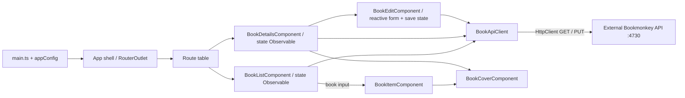

# Architecture and contributor guide

## Purpose and scope

BookMonkey is a small Angular workshop application for browsing, searching, viewing, and editing books. The [README](README.md) identifies the workshop context; the [rendered shell](src/app/app.html) and [books screen](src/app/books/book-list.component.ts) establish the current product behavior. There is one application, one feature, and no first-party library projects or backend implementation.

This guide describes the checked-out code, not an intended future architecture. **Verified** statements come from the linked files or checks below. **Inference** and **unknown** labels identify conclusions that the repository cannot establish. All first-party text files were inspected; dependency internals, generated caches/build output, and image binaries were grouped rather than exhaustively reviewed.

## Stack and dependencies

Declared versions below come from [package.json](package.json); resolutions come from the current [npm lockfile](package-lock.json), lockfile version 3. Angular core is declared, locked, and locally installed at **20.2.1**.

| Category               | Declared dependencies                                                                                                                                        | Role in this repository                                                                       |
| ---------------------- | ------------------------------------------------------------------------------------------------------------------------------------------------------------ | --------------------------------------------------------------------------------------------- |
| Angular runtime        | `@angular/core`, `common`, `compiler`, `forms`, `router`, `platform-browser`, `animations`: `20.2.1` each                                                    | Standalone browser app, routing, HTTP, search binding, reactive book form, animations         |
| UI                     | `@angular/material` `^20.2.0` (locked `20.2.0`), `@angular/cdk` `20.2.0`                                                                                     | Material snack-bar wrapper and style override; wrapper has no callers                         |
| Async/runtime helpers  | `rxjs` `7.8.0`, `zone.js` `0.15.0`, `tslib` `2.3.0`                                                                                                          | HTTP Observable, zone polyfill/change detection, TypeScript helpers                           |
| State/query packages   | `@ngrx/signals` `20.0.1`, `@angular-architects/ngrx-toolkit` `^20.1.0` (locked `20.1.0`), `@tanstack/angular-query-experimental` `^5.85.5` (locked `5.85.5`) | Production dependencies, but no source imports or providers; no implemented store/query layer |
| Server packages        | `@angular/platform-server`, `@angular/ssr` `20.2.1`; `express` `5.1.0`                                                                                       | Production dependencies, but no server entry point, SSR configuration, or Express application |
| Angular build tooling  | `@angular/build`, `@angular/cli` `20.2.0`; `@angular/compiler-cli` `20.2.1`; `typescript` `5.9.2`                                                            | Development dependencies for serving, compilation and builds                                  |
| Styling tooling        | `tailwindcss`, `@tailwindcss/postcss` `4.1.12`; `postcss` `8.5.6`                                                                                            | Development dependencies producing utility CSS                                                |
| Tests/formatting/types | `@playwright/test` `^1.55.0` (locked `1.55.0`), `prettier` `3.6.2`, `@types/node` `^20.17.19`, `@types/express` `^5.0.1`                                     | Development tooling; type packages are locked to `20.19.11` and `5.0.3` respectively          |

The project does not pin Node/npm through an `engines` field or version file. The locked Angular build package declares Node `^20.19.0 || ^22.12.0 || >=24.0.0`; validation here used Node `24.22.1` and npm `11.21.1`. These are observed tool versions, not a project policy.

## Directory map

| Location                                                                               | Responsibility                                                                                                 |
| -------------------------------------------------------------------------------------- | -------------------------------------------------------------------------------------------------------------- |
| [src/main.ts](src/main.ts), [src/index.html](src/index.html)                           | Browser bootstrap and HTML host (`app-root`, base URL `/`, system fonts)                                       |
| [src/app](src/app/app.ts)                                                              | Root shell, application-wide providers and route table                                                         |
| [src/app/books](src/app/books/book-list.component.ts)                                  | Only feature: list/search and details screens, display card, shared cover, HTTP client and `Book` interface    |
| [src/app/shared](src/app/shared/toast.service.ts)                                      | Root-provided theme service and unused toast wrapper                                                           |
| [src/styles.css](src/styles.css), [src/material-theme.scss](src/material-theme.scss)   | Tailwind entry and Material snack-bar color override                                                           |
| `public/`, `docs/`                                                                     | Favicon copied to build output; README workshop logo respectively                                              |
| [tests](tests/example.spec.ts), [tests-examples](tests-examples/demo-todo-app.spec.ts) | Mocked-API list/details regression tests and external-site starter tests; TodoMVC sample excluded by `testDir` |
| [angular.json](angular.json), [tsconfig.json](tsconfig.json)                           | Single-project build/serve/test targets; strict compiler options                                               |
| [.vscode](.vscode/launch.json)                                                         | Chrome debug launch settings, npm tasks and extension recommendations                                          |
| [recreate-tags.sh](recreate-tags.sh)                                                   | Workshop solution-tag maintenance, not application build/deployment                                            |

`node_modules/`, `.angular/cache/`, `dist/`, test reports and compiler output are generated/ignored locations; see [.gitignore](.gitignore). `newProjectRoot: "projects"` in Angular configuration is a scaffold setting; no `projects/` source tree exists.

## Startup, rendering and routing

1. [main.ts](src/main.ts) calls `bootstrapApplication(App, appConfig)` and logs bootstrap failures to the console.
2. [app.config.ts](src/app/app.config.ts) provides browser global error listeners, zone-based change detection with `eventCoalescing: true`, the router, `HttpClient`, and animations. [angular.json](angular.json) explicitly includes the `zone.js` polyfill.
3. A synchronous `provideAppInitializer` initializes the root-provided `ThemeService` before rendering. It reads `bookmonkey-theme` (`light`/`dark`) from localStorage, otherwise follows device color-scheme changes until the user toggles. Storage failures retain a session preference; the media listener is cleaned up on application destruction. The header switch applies `data-theme` to the document root; global CSS tokens set colors and native `color-scheme`, with a device-preference fallback before initialization. Constructors do not apply theme state.
4. [App](src/app/app.ts) supplies the header/footer and a `RouterOutlet` via an external template; its component CSS file is empty.
5. [routes](src/app/app.routes.ts) eagerly imports `BookListComponent` for the empty path. A wildcard redirects other paths to the empty path. It also eagerly imports `BookDetailsComponent` at `books/:id`. There are no lazy routes, guards, resolvers, or route-level providers.

All six components are standalone. The books components declare `standalone: true`; `App` omits the flag. This interpretation uses the [Angular 20 standalone default](https://v20.angular.dev/guide/components), verified through Context7. No first-party NgModule is defined; components still import framework modules such as `CommonModule`, `FormsModule`, and `ReactiveFormsModule`.

**Verified configuration:** no component declares a `changeDetection` strategy; the app explicitly configures zones. **Framework interpretation:** under [Angular 20's documented default strategy](https://v20.angular.dev/guide/components/advanced-configuration), these components use `Default`, not `OnPush`. This is not an explicit project convention. The [zone provider](https://v20.angular.dev/api/core/provideZoneChangeDetection) coalesces bubbling-event change detection; it is separate from the search debounce.

The configured application is client-rendered. No server bootstrap, hydration provider, prerender configuration, or SSR target is present despite the server dependencies.

## Components, services and data flow

**Initial load:** [BookListComponent](src/app/books/book-list.component.ts) exposes one lazy, typed `state$`, consumed once through `AsyncPipe` in its [external template](src/app/books/book-list.component.html). Subscription emits loading and requests `GET http://localhost:4730/books?_limit=10` through [BookApiClient](src/app/books/book-api-client.service.ts). Successful responses render cards or an empty state; failures render an inline error with Retry. Old results are hidden as soon as a new action starts. `trackById` uses `book.id` for list identity.

**Search:** the input uses `FormsModule` and two-way `ngModel` binding to `searchTerm`. Each change emits a search action. The outer `switchMap` immediately unsubscribes the previous timer or HTTP request, then delays typed searches by 300 ms. Initial load, Clear Search, and Retry bypass this delay. `HttpParams` supplies `_limit` and optional `q`; clearing omits `q`. Inner error recovery keeps later actions usable. `AsyncPipe` unsubscribes when navigating away, cancelling pending work. Search is not persisted or stored in the URL; actual backend matching semantics remain **unknown**.

**Details:** [BookDetailsComponent](src/app/books/book-details.component.ts) combines distinct route IDs with explicit retry actions. Switching IDs cancels the prior request and calls `getBook(id)`, which URL-encodes the ID for `GET /books/:id`. The local state distinguishes loading, loaded, HTTP 404 (not found), and other failures (inline Retry). A missing ID maps to not found without a request. The [external template](src/app/books/book-details.component.html) renders metadata, the full abstract, and a collection link. Direct links, reloads, and browser history work through the router. Dependencies and lazy stream composition use readonly field initializers; constructing the baseline details stream also did not eagerly fetch data.

**Editing:** the loaded details state uses local edit/cancel/saved actions to switch between the details and [BookEditComponent](src/app/books/book-edit.component.ts), keeping `books/:id` unchanged. The editor resets its typed reactive form from the original book. Title, description (`abstract`), and publisher reject empty/whitespace-only values, with per-field messages after touch or submission. Subtitle, author, page count, price, cover URL, and the three required fields are editable; ISBN is a visible read-only input outside the form model, and technical IDs are not controls. No extra price/URL/range rules are imposed. A blank page count is saved as 0, as stated beside the field; price stays a string.

The editor's single AsyncPipe owns the save stream. `exhaustMap` ignores concurrent submissions; a disabled fieldset protects pending inputs and actions. `BookApiClient.updateBook(original, changes)` copies the original resource and explicitly overwrites only the eight editable fields, retaining ISBN, ID, user ID, and other original metadata. Its full JSON `PUT /books/:id` returns the saved resource. Success updates the details state; Cancel destroys the draft without a request. Inner error recovery shows an inline message, retains all inputs, and allows another submission. Route changes destroy the editor and unsubscribe pending HTTP; cancellation cannot undo a write already accepted by the server. Keyboard focus moves to Title on edit and returns to Edit book on save/cancel.

**Presentation boundary:** [BookItemComponent](src/app/books/book-item.component.ts) receives `@Input() book!: Book`, renders the title as a details link using `RouterLink`, author, and optional subtitle/ISBN. Both cards and details delegate covers to [BookCoverComponent](src/app/books/book-cover.component.ts), whose required `cover` and `title` inputs drive image rendering. It owns missing/broken-image fallback and clears failure state when `cover` changes. Presentation components do not fetch data. [Book](src/app/books/book.ts) remains a TypeScript response interface; there is no response mapper or runtime schema validation.

The dependency direction is shell -> routes -> screen components -> API client -> Angular HTTP, with screens -> presentation components -> model. Shared code does not import books; books does not use shared code. There is no enforced module-boundary tooling.

Recurring patterns are standalone imports, root-provided services, local Observable state, `inject` field initialization in screens, constructor DI in services, and Tailwind classes. List/details/editor use external HTML; the smaller card/cover components retain inline templates. Existing `*ngIf`/`*ngFor` syntax is retained. Editing uses typed reactive forms; search retains template-driven binding. There is no application store or query cache. Only the explicit light/dark theme preference is persisted locally; book edits are persisted through the external API. These are conventions for this small feature, not evidence of a larger architecture.

## Integrations and cross-cutting concerns

- **HTTP/configuration:** the sole API URL is hard-coded in [BookApiClient](src/app/books/book-api-client.service.ts). `HttpParams` supplies `_limit` and optional `q`; GET and full-resource PUT are implemented. `pageSize` is an input defaulting to 10, with no route binding, pagination controls, offset, or input-change reload. Details and updates use URL-encoded original IDs on the same base URL. No environment files, runtime configuration, CLI file replacements, proxy, custom interceptors, automatic retries or explicit credential/header options are present. Retry/save buttons explicitly reissue requests.
- **Backend boundary:** [README](README.md) instructs running `npx bookmonkey-api` separately at port 4730. The API is neither vendored nor declared/locked here. The cached `bookmonkey-api` 3.3.0 source and bundled documentation were inspected for issue #1; an isolated in-memory server verified full JSON PUT, returned/saved values, preservation of original IDs (including an ID different from ISBN), 400 for missing API-required fields, and 404 for an absent book. The [upstream documentation](https://github.com/workshops-de/bookmonkey-api#supported-actions) calls the resource key `:isbn`; json-server resolves the stored `id`. Its deployment version, CORS policy, and production hosting remain **unknown**. Requests go directly from the browser to localhost; a deployed browser would target the visitor's machine unless configuration/code changes.
- **Authentication/authorization:** no login, token handling, session storage, auth service, guard, or permission checks exist in the inspected app. The model's `userId` alone does not establish authentication or authorization. Backend access rules are unknown.
- **Errors:** bootstrap failures use `console.error`; global browser error listeners remain registered. List/details requests recover into inline states with Retry, and details treats 404 separately. Empty results only follow a successful list response. Expected request errors are handled by screens rather than a global toast/interceptor. [ToastService](src/app/shared/toast.service.ts) wraps `MatSnackBar.open(message, 'Close', { duration })` with a 3-second default but remains unused. No remote error reporting is configured.
- **Styling/assets:** [styles.css](src/styles.css) imports Tailwind through [.postcssrc.json](.postcssrc.json); templates use responsive grid/utilities. [material-theme.scss](src/material-theme.scss) binds snack-bar colors to the shared theme tokens, with no full Material theme declaration. Typography uses local system serif/sans-serif stacks, with inline SVG icons and no remote font dependency. Card images use API-provided URLs. These create external resource dependencies; the shared cover component handles missing or failed images with a text fallback.

## Development, build, test and deployment

Commands are defined by [package.json](package.json), [angular.json](angular.json), and [Playwright configuration](playwright.config.ts). Use separate terminals for the API and frontend, or select **BookMonkey: Frontend + Backend** in the [VS Code launch configuration](.vscode/launch.json) and press **F5**. The debugger runs `npx --yes bookmonkey-api` on port 4730, waits for its ready message, launches the local Angular CLI on port 4200, then starts Chrome after Angular reports its local URL. `killOnServerStop` and `cascadeTerminateToConfigurations` link shutdown across these sessions. The standalone **ng serve** configuration starts Angular and Chrome for use with an already running API. The API remains an external, unpinned package; its first launch requires network access.

| Command                                                                  | Configured behavior / caveat                                                                                     |
| ------------------------------------------------------------------------ | ---------------------------------------------------------------------------------------------------------------- |
| `npm install`                                                            | README installation path; can update the lockfile                                                                |
| `npm ci`                                                                 | Lockfile-based clean installation alternative; not executed during this review                                   |
| `npx bookmonkey-api`                                                     | README backend command; unpinned external package, not executed during this review                               |
| `npm start`                                                              | `ng serve`, development configuration; Playwright/VS Code expect `http://localhost:4200`                         |
| `npm run build`                                                          | `ng build`, defaults to production; output hashing and size budgets enabled                                      |
| `npx ng build --configuration development`                               | Development build: optimization/license extraction disabled, source maps enabled                                 |
| `npm run watch`                                                          | Development build in watch mode; does not start a web server                                                     |
| `npm test`                                                               | Karma builder; currently incomplete dependencies (see below)                                                     |
| `npx playwright test`                                                    | Starts/reuses the frontend server, then runs `tests/` in Chromium, Firefox and WebKit; browser binaries required |
| `npx playwright test tests/book-details.spec.ts tests/book-list.spec.ts` | Runs application regressions only, with mocked API responses                                                     |
| `npx playwright test --list`                                             | Lists tests without running browsers or starting the server                                                      |
| `npm run format.write`                                                   | Formats configured extensions under `src/`; excludes this root guide and `.scss`                                 |

Production budgets are 500 kB warning / 1 MB error for initial bundles, and 4 kB / 8 kB for any component stylesheet. The development build produced browser artifacts under `dist/angular-workshop-modern/browser/`; no output path is explicitly set in Angular configuration. There is no checked-in CI pipeline, container, hosting configuration, deploy command, or deployment procedure. **Inference:** static hosting would need to serve browser artifacts and resolve client routes to `index.html`; the actual hosting arrangement is unknown.

Application regression coverage is in [details tests](tests/book-details.spec.ts), [list tests](tests/book-list.spec.ts), [editing tests](tests/book-edit.spec.ts), and [theme tests](tests/theme.spec.ts), with shared books, image responses, and API routes in [the fixture](tests/fixtures/books.ts). They exercise the local app with mocked HTTP, requiring no live backend. Editing tests use per-test stateful PUT/GET mocks to check saved values after reload/navigation. List timing/cancellation tests use Playwright clock control; the reused-cover input contract test uses Angular's development-only debug API to change the parent card input without recreating the cover. Existing [starter tests](tests/example.spec.ts) target playwright.dev; the [TodoMVC sample](tests-examples/demo-todo-app.spec.ts) is outside `testDir`. CI-sensitive retries/workers/`forbidOnly` are configured, but no CI pipeline is checked in. The legacy Karma target references Jasmine types, yet there are no source unit specs or locked Karma/Jasmine packages.

[recreate-tags.sh](recreate-tags.sh) deletes matching local tags, rebuilds solution tags from commit messages, and deletes/pushes corresponding remote tags. It is a repository maintenance script with remote effects, not a normal contributor setup command.

## Practical contributor guidance

- Read the scoped [root agent guide](AGENTS.md), [source guide](src/AGENTS.md), and [books guide](src/app/books/AGENTS.md). Start with routes, screen state streams, the API client and `Book` interface for book behavior. Keep HTTP construction in the client and rendering in input-driven components.
- Add feature routes in [app.routes.ts](src/app/app.routes.ts) and import template dependencies in the consuming standalone component. Lazy routing, stores and signal-based state would be new choices here; dependency presence alone does not establish their use.
- Follow [strict TypeScript/Angular template settings](tsconfig.json). There are no custom path aliases. Application compilation [excludes spec files](tsconfig.app.json); the spec configuration includes all source TS and requests Jasmine types.
- Follow [.prettierrc](.prettierrc) and [.editorconfig](.editorconfig): two spaces, single quotes, semicolons, no trailing commas, Prettier width 120 and LF. No lint script/configuration is present. [VS Code recommendations](.vscode/extensions.json) cover Angular Language Service and Prettier.
- For manual checks, exercise list load/search/clear/empty/error/retry, details deep links/404/retry, browser history, image fallback, keyboard navigation and mobile layout. Run the targeted application Playwright suites for regression coverage.
- For editing, also check required-field errors/correction, immutable ISBN/IDs, saving/reload, Cancel, retry after save failure, and navigation during a pending save. Include `tests/book-edit.spec.ts` and `tests/theme.spec.ts` in application regression runs.

## Limitations, open questions and validation

**Code-derived limitations:** changing `pageSize` after initialization does not trigger a reload by itself; the current value is used on the next search/clear/retry request. Search is not restored after returning from details. The API URL still targets localhost, and responses are only statically typed. The refactor adds request cancellation and explicit inline errors; the prior search race/timer issues are documented in [REFACTORING.md](REFACTORING.md).

**Unsettled architecture:** unused state/query/server dependencies and the unused toast wrapper may be workshop preparation or leftovers; their intended role cannot be determined. The root's implicit standalone metadata differs from the books components' explicit flags. The missing unit-test dependencies, lack of environment configuration, and absent deployment instructions should be resolved before relying on this as a production baseline. Whether any backend enforces access control remains unknown.

**Validation for the refactor:**

- Existing Angular 20 standalone/change-detection guidance and AsyncPipe teardown semantics were checked through Context7; RxJS cancellation was also checked against installed 7.8.0 source. Playwright clock usage was checked through Context7 and installed types.
- Development compilation passes using `node node_modules/@angular/cli/bin/ng.js build --configuration development`.
- Production compilation under sandbox network restrictions fails while inlining Google Fonts. This does not establish a source or budget failure; production completion/budgets were unverified at that point; see the later reading-room theme validation below.
- The legacy test command fails with `Cannot find module 'karma-jasmine'`; repairing it is outside this refactor.
- Playwright browsers are provisioned under ignored `tmp/playwright-browsers`. In PowerShell set `$env:PLAYWRIGHT_BROWSERS_PATH='D:\ki-software-engineer\tmp\playwright-browsers'` before running tests against this cache. Browser-download network access required an approved sandbox escalation; Firefox/WebKit tests also required approved elevated execution after sandboxed Firefox launch stalled.
- All 75 application regression cases pass (25 each in Chromium, Firefox and WebKit). Strict test TypeScript checking, targeted formatting and documentation links also pass. Detailed results and diff review are recorded in [REFACTORING.md](REFACTORING.md). Tests mock the backend and do not establish the live API contract or deployment behavior.

## Reading-room theme validation

Theme behavior is covered by `tests/theme.spec.ts` using mocked API responses, alongside the existing list/details suites. The palette covers both screens, cover fallbacks, and request states. Use desktop and 375px mobile checks for both themes. Remote font links were removed as part of the system-font design, eliminating the previous Google Fonts production-build dependency.

Verified on 2026-11-10: development and production compilation pass (production initial bundle 393.88 kB, within budgets). All **111 application cases pass**: 37 each in Chromium, Firefox, and WebKit, including 12 theme cases per browser. Theme cases verify keyboard switching, device defaults/changes, persistence, direct links, navigation/reload, invalid preferences, blocked storage, AA text-token contrast, and no horizontal overflow at 375px/1440px. Both themes and collection/details/loading/error/empty/missing-cover screenshots were visually inspected. Strict test TypeScript checking, targeted Prettier checks, and diff whitespace checks pass. The initial sandbox Firefox run could not create pages; the elevated Firefox/WebKit rerun passed all 74 cases. No live API was required. The pre-existing incomplete Karma target remains unverified and unchanged.

## Issue #1 editing validation

Implemented [issue #1](https://github.com/EHerche/ki-software-engineer/issues/1) on 2026-11-10, including the proposed edit/save/cancel/error flows (AC-6 through AC-9). The confirmed required-field rules are enforced; no additional price, cover URL, or page-range validation was added.

- Development and production compilation pass; the production initial bundle is **426.11 kB**, within budgets.
- All **162 application regression cases pass**: 54 each in Chromium, Firefox, and WebKit. Run `npx playwright test tests/book-details.spec.ts tests/book-list.spec.ts tests/book-edit.spec.ts tests/theme.spec.ts`. The 17 new cases per browser cover prefilling, all editable fields, unchanged ISBN/IDs, empty/whitespace validation and correction, persistence after reload/navigation, Cancel, server/network failures with retained drafts and retry, duplicate submission protection, route-change teardown, and both themes at 375px/1440px.
- The sandbox run passed all 108 Chromium/WebKit cases; Firefox failed before creating test pages. An approved elevated Firefox rerun passed all 54 cases without retries.
- Strict TypeScript checking for all application test files, targeted Prettier checks, architecture link checks, and `git diff --check` pass. Desktop light and mobile dark editor/validation screenshots were visually inspected.
- The external API update contract was checked separately with cached 3.3.0 middleware and an isolated in-memory database; no user book data was changed. Browser regressions use mocked API responses. The existing incomplete Karma target was not rerun or repaired.
