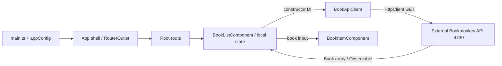

# Architecture and contributor guide

## Purpose and scope

BookMonkey is a small Angular workshop application for browsing and searching a book collection. The [README](README.md) identifies the workshop context; the [rendered shell](src/app/app.html) and [books screen](src/app/books/book-list.component.ts) establish the current product behavior. There is one application, one feature, and no first-party library projects or backend implementation.

This guide describes the checked-out code, not an intended future architecture. **Verified** statements come from the linked files or checks below. **Inference** and **unknown** labels identify conclusions that the repository cannot establish. All first-party text files were inspected; dependency internals, generated caches/build output, and image binaries were grouped rather than exhaustively reviewed.

## Stack and dependencies

Declared versions below come from [package.json](package.json); resolutions come from the current [npm lockfile](package-lock.json), lockfile version 3. Angular core is declared, locked, and locally installed at **20.2.1**.

| Category | Declared dependencies | Role in this repository |
| --- | --- | --- |
| Angular runtime | `@angular/core`, `common`, `compiler`, `forms`, `router`, `platform-browser`, `animations`: `20.2.1` each | Standalone browser app, routing, HTTP, template-driven search input, animation provider |
| UI | `@angular/material` `^20.2.0` (locked `20.2.0`), `@angular/cdk` `20.2.0` | Material snack-bar wrapper and style override; wrapper has no callers |
| Async/runtime helpers | `rxjs` `7.8.0`, `zone.js` `0.15.0`, `tslib` `2.3.0` | HTTP Observable, zone polyfill/change detection, TypeScript helpers |
| State/query packages | `@ngrx/signals` `20.0.1`, `@angular-architects/ngrx-toolkit` `^20.1.0` (locked `20.1.0`), `@tanstack/angular-query-experimental` `^5.85.5` (locked `5.85.5`) | Production dependencies, but no source imports or providers; no implemented store/query layer |
| Server packages | `@angular/platform-server`, `@angular/ssr` `20.2.1`; `express` `5.1.0` | Production dependencies, but no server entry point, SSR configuration, or Express application |
| Angular build tooling | `@angular/build`, `@angular/cli` `20.2.0`; `@angular/compiler-cli` `20.2.1`; `typescript` `5.9.2` | Development dependencies for serving, compilation and builds |
| Styling tooling | `tailwindcss`, `@tailwindcss/postcss` `4.1.12`; `postcss` `8.5.6` | Development dependencies producing utility CSS |
| Tests/formatting/types | `@playwright/test` `^1.55.0` (locked `1.55.0`), `prettier` `3.6.2`, `@types/node` `^20.17.19`, `@types/express` `^5.0.1` | Development tooling; type packages are locked to `20.19.11` and `5.0.3` respectively |

The project does not pin Node/npm through an `engines` field or version file. The locked Angular build package declares Node `^20.19.0 || ^22.12.0 || >=24.0.0`; validation here used Node `24.22.1` and npm `11.21.1`. These are observed tool versions, not a project policy.

## Directory map

| Location | Responsibility |
| --- | --- |
| [src/main.ts](src/main.ts), [src/index.html](src/index.html) | Browser bootstrap and HTML host (`app-root`, base URL `/`, external fonts) |
| [src/app](src/app/app.ts) | Root shell, application-wide providers and route table |
| [src/app/books](src/app/books/book-list.component.ts) | Only feature: list/search container, display card, HTTP client and `Book` interface |
| [src/app/shared](src/app/shared/toast.service.ts) | Root-provided toast wrapper; currently unused |
| [src/styles.css](src/styles.css), [src/material-theme.scss](src/material-theme.scss) | Tailwind entry and Material snack-bar color override |
| `public/`, `docs/` | Favicon copied to build output; README workshop logo respectively |
| [tests](tests/example.spec.ts), [tests-examples](tests-examples/demo-todo-app.spec.ts) | Playwright external-site starter tests; TodoMVC sample excluded by configured `testDir` |
| [angular.json](angular.json), [tsconfig.json](tsconfig.json) | Single-project build/serve/test targets; strict compiler options |
| [.vscode](.vscode/launch.json) | Chrome debug launch settings, npm tasks and extension recommendations |
| [recreate-tags.sh](recreate-tags.sh) | Workshop solution-tag maintenance, not application build/deployment |

`node_modules/`, `.angular/cache/`, `dist/`, test reports and compiler output are generated/ignored locations; see [.gitignore](.gitignore). `newProjectRoot: "projects"` in Angular configuration is a scaffold setting; no `projects/` source tree exists.

## Startup, rendering and routing

1. [main.ts](src/main.ts) calls `bootstrapApplication(App, appConfig)` and logs bootstrap failures to the console.
2. [app.config.ts](src/app/app.config.ts) provides browser global error listeners, zone-based change detection with `eventCoalescing: true`, the router, `HttpClient`, and animations. [angular.json](angular.json) explicitly includes the `zone.js` polyfill.
3. [App](src/app/app.ts) supplies the header/footer and a `RouterOutlet` via an external template; its component CSS file is empty.
4. [routes](src/app/app.routes.ts) eagerly imports `BookListComponent` for the empty path. A wildcard redirects other paths to the empty path. There are no lazy routes, guards, resolvers, detail routes, or route-level providers.

All three components are standalone. The books components declare `standalone: true`; `App` omits the flag. This interpretation uses the [Angular 20 standalone default](https://v20.angular.dev/guide/components), verified through Context7. No first-party NgModule is defined; components still import framework modules such as `CommonModule` and `FormsModule`.

**Verified configuration:** no component declares a `changeDetection` strategy; the app explicitly configures zones. **Framework interpretation:** under [Angular 20's documented default strategy](https://v20.angular.dev/guide/components/advanced-configuration), these components use `Default`, not `OnPush`. This is not an explicit project convention. The [zone provider](https://v20.angular.dev/api/core/provideZoneChangeDetection) coalesces bubbling-event change detection; it is separate from the search debounce.

The configured application is client-rendered. No server bootstrap, hydration provider, prerender configuration, or SSR target is present despite the server dependencies.

## Components, services and data flow

**Initial load:** [BookListComponent](src/app/books/book-list.component.ts) runs `loadBooks()` in `ngOnInit`. Its root-provided [BookApiClient](src/app/books/book-api-client.service.ts) creates `GET http://localhost:4730/books?_limit=10`. A direct subscription assigns the response to `books` and clears `loading`. The template shows a spinner during loading, otherwise cards or an empty state. `trackById` uses `book.id` for list identity.

**Search:** the single text input uses `FormsModule` and two-way `ngModel` binding to `searchTerm`. Each `ngModelChange` resets a 300 ms `setTimeout`; its callback requests the same endpoint with `_limit` and optional `q`. Clear Search sets the term to empty and immediately reloads without `q`. Search state is not stored in the URL or persisted. The service comment says title/author search, but actual matching semantics are **unknown** without inspecting the external API.

**Presentation boundary:** [BookItemComponent](src/app/books/book-item.component.ts) receives `@Input() book!: Book`, renders title, author, optional subtitle/ISBN and a cover or missing-cover fallback. It neither fetches data nor emits events. It imports `RouterModule` but has no navigation bindings. [Book](src/app/books/book.ts) is a TypeScript response interface (including a single `author` string and string `id`); there is no response mapper or runtime schema validation.

The implemented dependency direction is shell → route → list → API client → Angular HTTP, with list → card → model. Shared code does not import the books feature; the books feature does not currently use shared code. There is no enforced module-boundary tooling.

Recurring patterns across this small sample are standalone component imports, constructor dependency injection in both services and the list, root-provided services, class-property state and Tailwind utility classes. Both books templates are inline and use `*ngIf`/`*ngFor`; the shell uses external HTML/CSS. There are no signals, reactive forms, async-pipe subscriptions, application store, query cache, or persistence in first-party source. With one feature, these are observed practices, not evidence of a wider enforced architecture.

## Integrations and cross-cutting concerns

- **HTTP/configuration:** the sole API URL is hard-coded in [BookApiClient](src/app/books/book-api-client.service.ts). `HttpParams` supplies `_limit` and optional `q`; only GET is implemented. `pageSize` is an input defaulting to 10, with no route binding, pagination controls, offset, or input-change reload. No environment files, runtime configuration, CLI file replacements, proxy, custom interceptors, retries or explicit credential/header options are present.
- **Backend boundary:** [README](README.md) instructs running `npx bookmonkey-api` separately at port 4730. The API is neither vendored nor declared/locked here. Its version, endpoint implementation, response contract, CORS policy, and production hosting are **unknown**. Requests go directly from the browser to localhost; a deployed browser would target the visitor's machine unless configuration/code changes.
- **Authentication/authorization:** no login, token handling, session storage, auth service, guard, or permission checks exist in the inspected app. The model's `userId` alone does not establish authentication or authorization. Backend access rules are unknown.
- **Errors:** bootstrap failures and list HTTP failures use `console.error`; global browser error listeners are registered. A failed list request clears `loading` without recording an error state or clearing old data, so initial failure can appear as an empty collection and later failure can retain previous results. [ToastService](src/app/shared/toast.service.ts) wraps `MatSnackBar.open(message, 'Close', { duration })` with a 3-second default but is never called. No remote error reporting is configured.
- **Styling/assets:** [styles.css](src/styles.css) imports Tailwind through [.postcssrc.json](.postcssrc.json); templates use responsive grid/utilities. [material-theme.scss](src/material-theme.scss) only overrides snack-bar container color, with no full Material theme declaration. [index.html](src/index.html) loads Google Fonts/Material Icons, and card images use API-provided URLs. These create external resource dependencies; there is no image-loading error handler.

## Development, build, test and deployment

Commands are defined by [package.json](package.json), [angular.json](angular.json), and [Playwright configuration](playwright.config.ts). Use separate terminals for the API and frontend.

| Command | Configured behavior / caveat |
| --- | --- |
| `npm install` | README installation path; can update the lockfile |
| `npm ci` | Lockfile-based clean installation alternative; not executed during this review |
| `npx bookmonkey-api` | README backend command; unpinned external package, not executed during this review |
| `npm start` | `ng serve`, development configuration; Playwright/VS Code expect `http://localhost:4200` |
| `npm run build` | `ng build`, defaults to production; output hashing and size budgets enabled |
| `npx ng build --configuration development` | Development build: optimization/license extraction disabled, source maps enabled |
| `npm run watch` | Development build in watch mode; does not start a web server |
| `npm test` | Karma builder; currently incomplete dependencies (see below) |
| `npx playwright test` | Starts/reuses the frontend server, then runs `tests/` in Chromium, Firefox and WebKit; browser binaries required |
| `npx playwright test --list` | Lists tests without running browsers or starting the server |
| `npm run format.write` | Formats configured extensions under `src/`; excludes this root guide and `.scss` |

Production budgets are 500 kB warning / 1 MB error for initial bundles, and 4 kB / 8 kB for any component stylesheet. The development build produced browser artifacts under `dist/angular-workshop-modern/browser/`; no output path is explicitly set in Angular configuration. There is no checked-in CI pipeline, container, hosting configuration, deploy command, or deployment procedure. **Inference:** static hosting would need to serve browser artifacts and resolve client routes to `index.html`; the actual hosting arrangement is unknown.

Testing is scaffolded rather than application-specific. [tests/example.spec.ts](tests/example.spec.ts) contains two tests of `https://playwright.dev/`, yielding six cases across three browser projects. The larger [TodoMVC sample](tests-examples/demo-todo-app.spec.ts) targets an external demo and is outside `testDir`. Playwright starts the local app but neither configured test checks BookMonkey or starts its API. CI-sensitive retries/workers/`forbidOnly` are configured, but that does not establish an actual CI pipeline. The Karma target references Jasmine types in [tsconfig.spec.json](tsconfig.spec.json), yet there are no `src/**/*.spec.ts` files or locked Karma/Jasmine test packages.

[recreate-tags.sh](recreate-tags.sh) deletes matching local tags, rebuilds solution tags from commit messages, and deletes/pushes corresponding remote tags. It is a repository maintenance script with remote effects, not a normal contributor setup command.

## Practical contributor guidance

- Start with the route table, list container, API client and `Book` interface when changing book behavior. Keep endpoint/query construction in the API client and card rendering in the input-driven card to follow existing boundaries.
- Add feature routes in [app.routes.ts](src/app/app.routes.ts) and import template dependencies in the consuming standalone component. Lazy routing, stores and signal-based state would be new choices here; dependency presence alone does not establish their use.
- Follow [strict TypeScript/Angular template settings](tsconfig.json). There are no custom path aliases. Application compilation [excludes spec files](tsconfig.app.json); the spec configuration includes all source TS and requests Jasmine types.
- Follow [.prettierrc](.prettierrc) and [.editorconfig](.editorconfig): two spaces, single quotes, semicolons, no trailing commas, Prettier width 120 and LF. No lint script/configuration is present. [VS Code recommendations](.vscode/extensions.json) cover Angular Language Service and Prettier.
- For a manual feature check, run the API and app, then exercise initial load, search, clear, empty results and API failure. Existing browser examples provide no regression coverage for those flows.

## Limitations, open questions and validation

**Code-derived limitations:** search debouncing does not cancel in-flight HTTP requests or reject stale responses, so older responses can overwrite newer results and competing requests can clear `loading` early. There is no destruction cleanup for the timer/subscriptions; Clear Search does not cancel a pending timer. These are risks inferred from control flow, not reproduced race failures. `pageSize` changes after initialization are not observed. Errors are not distinguished from empty data in the UI.

**Unsettled architecture:** unused state/query/server dependencies and the unused toast wrapper may be workshop preparation or leftovers; their intended role cannot be determined. The root's implicit standalone metadata differs from the books components' explicit flags. The missing unit-test dependencies, external-only browser tests, lack of environment configuration, and absent deployment instructions should be resolved before relying on this as a production baseline. Whether any backend enforces access control remains unknown.

**Validation performed for this guide:**

- Inspected every first-party source file, root README, manifest/lockfile, Angular/TypeScript/PostCSS/formatter configuration, both test folders, VS Code configuration, ignore rules and tag script. No additional on-disk `AGENTS.md` or nested README was found; the supplied repository instructions were followed. Angular 20 standalone/change-detection semantics were checked via Context7 against versioned Angular documentation.
- Development compilation passed using the installed CLI directly: `node node_modules/@angular/cli/bin/ng.js build --configuration development` (the same build target documented above).
- `npm run build` failed while inlining Google Fonts because this environment denied the network connection. Production build completion/budgets remain unverified; the successful development build does not establish production success.
- `npm test` failed with `Cannot find module 'karma-jasmine'`. Playwright test discovery passed with six cases; browsers, application/API behavior, backend contract and deployment were not exercised.
- Relative documentation links and command mappings were checked, and the final documentation diff reviewed. The pre-existing `package-lock.json` modification was preserved; application code was not changed.
